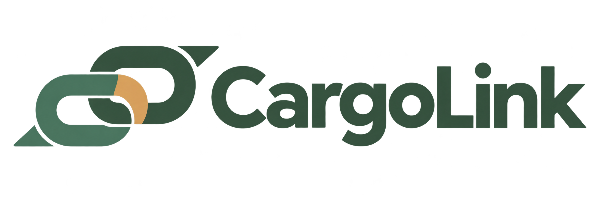

<div align="center">
  

  <h1>CargoLink</h1>
  <p><strong>Vos marchandises, le bon transporteur.</strong></p>
  <p>Une plateforme qui rapproche les PME et les transporteurs indépendants<br>pour organiser le transport de marchandises partout en Tunisie.</p>

  <p>
    
    
    
    
  </p>

  <p>
    <a href="#présentation">Présentation</a> ·
    <a href="#modules-métier">Modules</a> ·
    <a href="#technologies">Technologies</a> ·
    <a href="#installation">Installation</a> ·
    <a href="#équipe">Équipe</a>
  </p>
</div>

---

## Présentation

**CargoLink** centralise les besoins d’expédition des petites et moyennes entreprises et les capacités de transport disponibles. La plateforme accompagne le parcours logistique : publication d’une demande, mise en relation, proposition d’une offre et suivi du transport jusqu’à la réception.

L’objectif est de faciliter l’organisation des expéditions, de mieux utiliser l’espace disponible dans les véhicules et de contribuer à réduire les trajets à vide.

> **Un besoin, une offre, une livraison.** Une information claire à chaque étape du transport.

## Espaces utilisateurs

| Acteur | Rôle dans la plateforme |
| :--- | :--- |
| **PME / Expéditeur** | Décrire les marchandises à expédier, publier une demande, consulter les offres et suivre l’expédition. |
| **Transporteur** | Gérer ses véhicules et disponibilités, publier ses trajets, proposer ses offres et actualiser le suivi. |
| **Destinataire** | Consulter l’avancement de la livraison, confirmer la réception et signaler une anomalie. |
| **Administrateur** | Administrer les comptes utilisateurs et superviser les données de la plateforme. |

## Modules métier

Le périmètre fonctionnel de CargoLink s’organise autour des modules suivants.

| Module | Fonctionnalités principales |
| :--- | :--- |
| **Utilisateurs et authentification** | Inscription, connexion, gestion des rôles et des comptes, réinitialisation du mot de passe par code envoyé par e-mail. |
| **Demandes de transport** | Création des demandes PME, gestion des marchandises, poids et volume, adresses, dates, budget, publication ou enregistrement en brouillon. |
| **Véhicules et disponibilités** | Gestion du parc, immatriculations, types de véhicules, capacités, photos, états et créneaux de disponibilité. |
| **Matching et mise en relation** | Rapprochement des besoins d’expédition et des capacités disponibles pour faciliter la recherche d’un transport adapté. |
| **Gestion des trajets et suivi** | Publication des trajets, candidature aux demandes par une offre tarifée, gestion des offres et actualisation de l’état des trajets. |
| **Réception des livraisons** | Consultation du suivi côté destinataire et confirmation de la réception. |
| **Avis et réclamations** | Évaluation du service et signalement des problèmes rencontrés pendant une expédition. |

### Applications présentes dans ce dépôt

- **`authentification`** : comptes, rôles, authentification et administration des utilisateurs.
- **`demandes`** : demandes de transport et marchandises associées.
- **`vehicules`** : véhicules et disponibilités, avec validation des capacités et des périodes.
- **`gestion_trajets`** : trajets, offres de transport et suivi par état, avec formulaires en popup.

Le projet évolue par intégration des modules. Certains écrans, notamment la comparaison des offres, la réception et les réclamations, comportent encore des parcours de démonstration. Le tableau métier présente le périmètre du produit ; toutes ces fonctionnalités ne sont pas encore finalisées dans cette version du dépôt.

### Focus : gestion des trajets et suivi

L’application `gestion_trajets` est dédiée à l’espace transporteur. Elle s’appuie sur deux modèles : **`Trajet`** et **`OffreTransport`**, liés aux demandes de transport existantes.

- Consultation et recherche des demandes ouvertes publiées par les PME.
- Création et modification des trajets et des offres dans des popups.
- Confirmation avant suppression et spinner pendant les requêtes.
- Gestion des états : **Publié → En cours → Terminé**, avec possibilité d’annulation.
- Accès limité aux données du transporteur connecté.

Pour proposer une offre, le transporteur sélectionne un de ses trajets **publiés**, dont le départ est à venir. Le formulaire vérifie les villes, les dates et la capacité. Une seule offre est autorisée par transporteur et par demande ; les offres acceptées sont protégées contre la modification et la suppression.

## Technologies

| Technologie | Utilisation |
| :--- | :--- |
| **Python 3.13+** | Langage du backend et des règles métier. |
| **Django 6.1.2** | Vues, formulaires, authentification, ORM, migrations et administration. |
| **SQLite** | Stockage des données en développement local. |
| **Django Templates · HTML5** | Construction des pages et des espaces utilisateurs côté serveur. |
| **CSS3** | Mise en page responsive et identité visuelle CargoLink. |
| **JavaScript · Fetch API** | Interactions, chargement des popups et soumission asynchrone des formulaires. |
| **Pillow** | Prise en charge des images des véhicules avec les champs image de Django. |
| **uv** | Gestion des dépendances et de l’environnement Python, avec versions verrouillées dans `uv.lock`. |
| **Git** | Gestion des versions et collaboration sur le code. |

### Identité visuelle

L’interface associe un **vert profond**, des accents **sable doré** et des surfaces claires. Les polices **Plus Jakarta Sans** et **Inter**, les cartes arrondies et les indicateurs d’état structurent les écrans pour faciliter la lecture.

Les références graphiques sont documentées dans [DESIGN.md](DESIGN.md). Le logo de l’application est disponible dans [static/images/LogoCargoLink.png](static/images/LogoCargoLink.png).

## Installation

### Prérequis

- Python **3.13 ou supérieur**.
- **uv** installé.
- Une copie locale du dépôt.

Depuis la racine du projet :

```powershell
uv sync
uv run python manage.py migrate
uv run python manage.py runserver
```

Ouvrir ensuite **[http://localhost:8000/](http://localhost:8000/)**.

### Compte administrateur

```powershell
uv run python manage.py createsuperuser
```

L’administration Django est accessible à l’adresse **[http://localhost:8000/admin/](http://localhost:8000/admin/)**.

### Configuration des e-mails

Pour l’envoi des codes de réinitialisation par Gmail, renseigner un fichier `.env` à la racine :

```dotenv
EMAIL_HOST_USER=votre-adresse@gmail.com
EMAIL_HOST_PASSWORD=votre-mot-de-passe-application
```

Sans identifiants, les e-mails sont affichés dans la console de développement. Le fichier `.env` est exclu du suivi Git.

## Organisation du projet

```text
CargoLink/
├── CargoLink/          # Configuration Django et routage des espaces
├── authentification/  # Comptes, rôles et authentification
├── demandes/          # Demandes de transport et marchandises
├── vehicules/         # Parc de véhicules et disponibilités
├── gestion_trajets/   # Trajets, offres et suivi transporteur
├── templates/         # Pages communes et interfaces par acteur
├── static/            # Styles, scripts et images de l’application
├── public/            # Ressources publiques
├── DESIGN.md          # Charte graphique
├── manage.py          # Commandes de gestion Django
├── pyproject.toml     # Dépendances et configuration du projet
└── uv.lock            # Versions verrouillées des dépendances
```

## Vérifications

```powershell
# Vérifier la configuration du projet
uv run python manage.py check

# Exécuter les tests
uv run python manage.py test

# Exécuter uniquement les tests du module trajets et suivi
uv run python manage.py test gestion_trajets
```

La documentation détaillée du module transporteur se trouve dans [gestion_trajets/README.md](gestion_trajets/README.md).

## Équipe

| Membres du projet |
| :--- |
| **Nassef Fadhlaoui** |
| **Ayoub Belhameid** |
| **Souhir Krizi** |
| **Mustafa Charfeddine Akkez** |
| **Yassmine Ben Belgacem** |

---

<div align="center">
  <strong>CargoLink — Le lien entre vos marchandises et les bonnes capacités.</strong><br>
  <sub>Pensé pour les routes tunisiennes.</sub>
</div>
